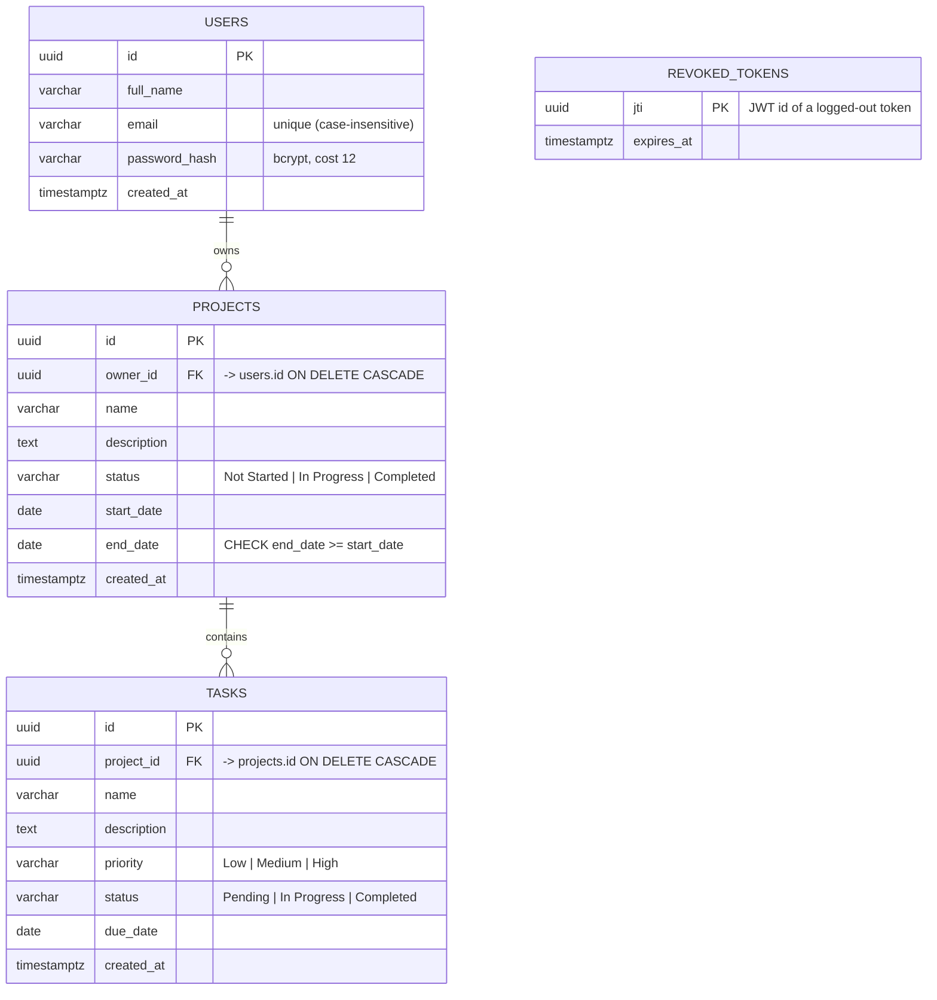

# Database Schema / ER Diagram

PostgreSQL, 3rd normal form. Source of truth: [`backend/db/schema.sql`](../backend/db/schema.sql).

## Design notes
- **Ownership chain:** `users -> projects -> tasks`. Tasks have no `owner_id`; every task query joins through `projects.owner_id`, so a task can never be accessed without owning its project (no duplicated ownership data to drift out of sync).
- **Integrity:** foreign keys with `ON DELETE CASCADE`; `CHECK` constraints enforce the status / priority enums and date ordering even if the API were bypassed.
- **Indexes:** `projects(owner_id)`, `tasks(project_id)`, `tasks(status)`, unique `lower(email)`.
- **Logout:** `revoked_tokens` stores the `jti` of logged-out JWTs until they expire; the auth middleware rejects them.
